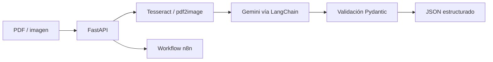

# OCR + LLM — Extracción de Datos de Facturas


[English](README.md) | [Español](README.es.md)

> Proyecto de hackathon **Anti Loop Day**, Universidad Nacional de General Sarmiento, 2025.

## El problema

La carga manual de datos de facturas y comprobantes es lenta y propensa a errores. El objetivo era tomar un PDF o una imagen y devolver datos estructurados listos para validar y persistir.

## La solución

Un servicio FastAPI que combina **OCR** y un **LLM** para extraer campos de facturas:

- Tipo de documento.
- Monto total.
- Fecha.
- Razón social y CUIT.
- Tipo y número de factura.
- CAE y punto de venta.

La salida del LLM se valida con esquemas **Pydantic** antes de responder, para que respuestas incompletas o mal formadas fallen de forma controlada.

## Arquitectura



## Estructura

```text
├── python_agent.py          # app FastAPI + extracción OCR/LLM
├── index.html               # UI de demo
├── Dockerfile
├── docker-compose.yml
├── requirements.txt
├── My workflow-n8n.json     # workflow de automatización
└── LICENSE
```

## Datos extraídos

| Campo | Ejemplo |
|---|---|
| Tipo de documento | Factura A |
| Monto total | 125000.00 |
| Fecha | 2025-11-20 |
| Razón social | Acme S.A. |
| CUIT | 30-12345678-9 |
| Número de factura | 0001-00001234 |
| CAE | 75123456789012 |

## Mi rol

- Endpoint FastAPI para subir archivos y extraer datos.
- Pipeline de OCR para PDFs e imágenes.
- Diseño de prompt y schema para una salida estructurada confiable.
- Capa de validación con Pydantic.
- Docker y workflow n8n para automatización posterior.

## Cómo ejecutarlo

```bash
cp .env.example .env
# editar .env y completar GEMINI_API_KEY
docker compose up --build
```

La API queda en el puerto `8000`. La UI de demo es `index.html`.

## Stack

`Python` · `FastAPI` · `LangChain` · `Gemini` · `Tesseract` · `pdf2image` · `Pydantic` · `Docker` · `n8n`

## Notas

- No hay API keys ni webhooks reales en el repo.
- El workflow de n8n apunta al servicio local `python_agent`.
- Código publicado con fines de portfolio bajo licencia MIT.
