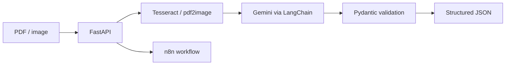

# OCR + LLM — Invoice Data Extraction


[English](README.md) | [Español](README.es.md)

> Hackathon project for **Anti Loop Day**, Universidad Nacional de General Sarmiento, 2025.

## The problem

Manual data entry from invoices and receipts is slow and error-prone. The goal was to take a PDF or image and return structured data ready to validate and persist.

## The solution

A FastAPI service that combines **OCR** and an **LLM** to extract fields from invoices:

- Document type.
- Total amount.
- Date.
- Business name and tax ID (CUIT).
- Invoice type and number.
- CAE and point of sale.

The LLM output is validated with **Pydantic** schemas before returning it, so malformed or partial responses fail gracefully.

## Architecture



## Repository layout

```text
├── python_agent.py          # FastAPI app + OCR/LLM extraction
├── index.html               # demo UI
├── Dockerfile
├── docker-compose.yml
├── requirements.txt
├── My workflow-n8n.json     # automation workflow
└── LICENSE
```

## Extracted data

| Field | Example |
|---|---|
| Document type | Factura A |
| Total amount | 125000.00 |
| Date | 2025-11-20 |
| Business name | Acme S.A. |
| CUIT | 30-12345678-9 |
| Invoice number | 0001-00001234 |
| CAE | 75123456789012 |

## My role

- FastAPI endpoint for file upload and extraction.
- OCR pipeline for PDFs and images.
- Prompt and schema design for reliable structured output.
- Validation layer with Pydantic.
- Docker setup and n8n workflow for downstream automation.

## Running locally

```bash
cp .env.example .env
# edit .env and set GEMINI_API_KEY
docker compose up --build
```

The API is exposed on port `8000`. The demo UI is `index.html`.

## Stack

`Python` · `FastAPI` · `LangChain` · `Gemini` · `Tesseract` · `pdf2image` · `Pydantic` · `Docker` · `n8n`

## Notes

- No API keys or real webhook URLs are committed.
- The n8n workflow points to the local `python_agent` service.
- Code published for portfolio purposes under the MIT license.
